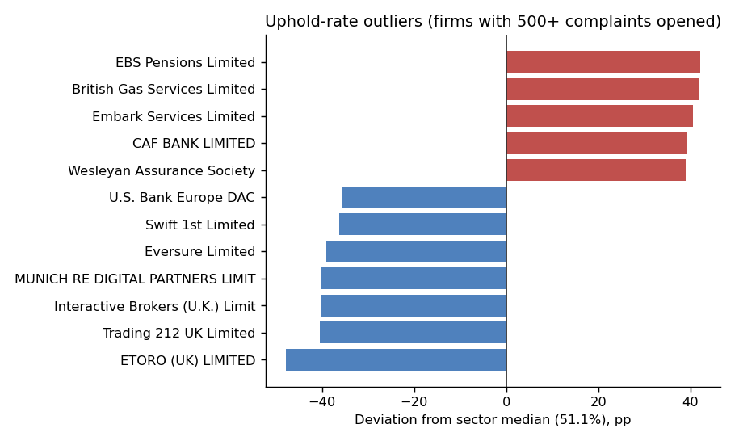

# UK Financial Services Complaints Dashboard

An operational analytics view over the **FCA's firm-specific complaints data**
— complaint volumes, uphold rates and product-group breakdowns for every UK
regulated firm reporting 500+ complaints in H2 2025.

**Live demo:** https://ellyshoon.github.io/uk-complaints-dashboard/ — a static snapshot
of the H2 2025 release that opens in any browser. The Streamlit app in this repo is
the full interactive version.

The question it answers is not "who gets the most complaints" (that is mostly
a proxy for how many customers a firm has). It is:

> **Which firms are unusually bad at resolving complaints in their favour, and
> where does that concentrate?**

## Headline findings, H2 2025

- **219 firms**, **427 firm-by-product-group rows**, **1.65m complaints
  opened** across the five product groups in this file.
- **Banking and credit cards** and **Insurance & pure protection** together
  account for 88.7% of all complaints.
- **Decumulation & pensions** has the highest uphold rate at 69.3% — pension
  complaints that get made tend to be upheld.
- The clearest outlier pattern: **investment and trading platforms cluster at
  very low uphold rates** — eToro (3.3%), Trading 212 (10.7%) and Interactive
  Brokers (10.7%) all sit 40+ points below the 51.1% sector median — while
  **insurers and pension providers cluster at very high ones**: British Gas
  Services (93.1%), EBS Pensions (93.2%), Embark Services (91.7%).

That split is worth a hypothesis, not a conclusion: it may reflect genuinely
different complaint-handling quality, or it may reflect what kind of dispute
each sector typically receives (a trading-platform complaint is often a
market-movement dispute a firm has no obligation to uphold; a pensions
complaint is more often a process error the firm caused). The dashboard
surfaces the pattern; it doesn't adjudicate it.



## Why these two measures

**Uphold rate against the sector median.** A firm losing most of the
complaints it contests is failing at first-line resolution before the
complaint even escalates — an operations signal, not a sentiment one.

**Volume by product group.** Complaint volume is not evenly spread, and where
it concentrates should drive where a supervisory or commercial team looks
first.

## Two decisions that shape the analysis, and why

**Uphold rates are volume-weighted, not averaged**, both by firm and by
product group. A firm closing 90,000 complaints and one closing 700 do not
move the sector figure equally under a weighted average — they would under a
naive `.mean()`.

**Outlier detection has a volume floor** (500 complaints opened, adjustable in
the dashboard). Uphold rate is a ratio; ratios with tiny denominators are
noise. Deviation is measured against the **median**, scaled by **IQR**, rather
than mean and standard deviation — the uphold-rate distribution has a long
right tail that would otherwise drag a z-score toward the very outliers it's
meant to catch.

## The file format was the actual hard part

FCA's firm-level release is not one flat table — it's an 11-sheet workbook
where the sheets that matter are **wide** (one column per product group), a
blank cell means "didn't report here" rather than zero, redress figures don't
exist at this level at all (they're aggregate-only), and each firm's
reporting period is its own financial-year-aligned window rather than a
single date range for the whole file. `src/etl.py` melts and merges the five
metric sheets into one long table and documents each of those decisions in
place — see `data/README.md` for the full shape.

## Running it

```bash
pip install -r requirements.txt

python scripts/run_analysis.py                                  # uses the file in data/
python scripts/run_analysis.py data/your-download.xlsx          # against a different release

streamlit run app.py                                            # interactive version
python scripts/build_static_dashboard.py                        # rebuilds docs/index.html (the web snapshot)
```

## Dashboard

Four tabs: an overview of volume and uphold rate by firm and product group, an
uphold-outlier view with an adjustable volume floor, a firm-level drill-down,
and the Consumer Credit return shown separately (see below).

`docs/index.html` is a lighter static version — overview, largest firms and the
outlier chart with its volume-floor slider — that needs no Python. The data is embedded
at build time, so it is a snapshot of one release and does not update.

## Limitations

- **Consumer Credit is a different return with a different firm population**
  — only 77 of its 151 firms also appear in the main return. It is shown as
  its own tab rather than merged into the main figures, because merging would
  silently combine two different reporting regimes into one number.
- **Uphold rate is not a clean quality measure.** A firm with a generous
  goodwill policy uphold more complaints while treating customers better, not
  worse. The metric flags firms worth investigating; it does not rank them
  morally.
- **This file excludes firms under the reporting threshold** (500 complaints
  in six months, or 1,000 a year). Their volumes are folded into the FCA's
  separate aggregate statistics but not broken out by firm.
- **No redress data at all** is available at firm level — see above.

## Licence

MIT. FCA data is published under the Open Government Licence v3.0.
